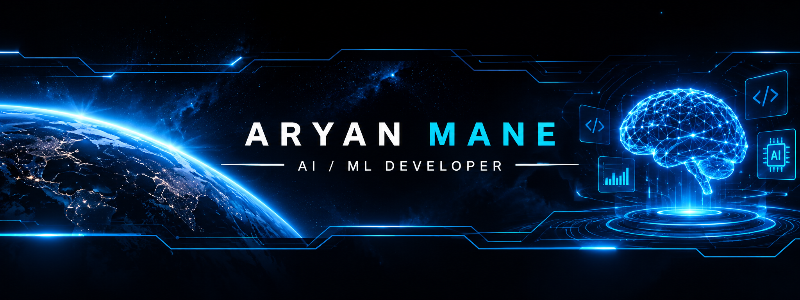
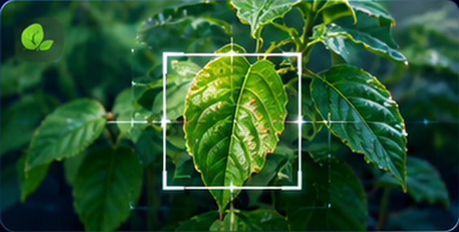
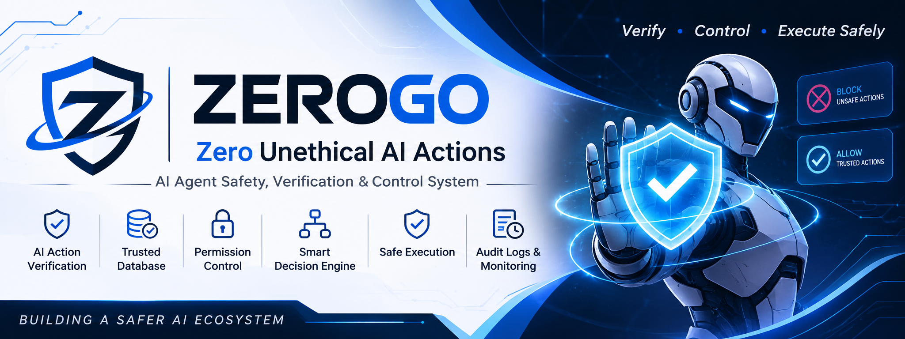
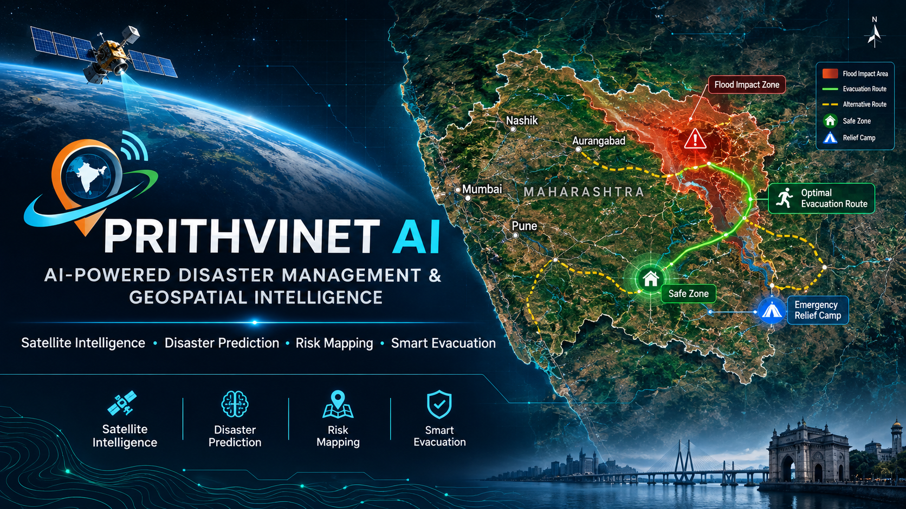
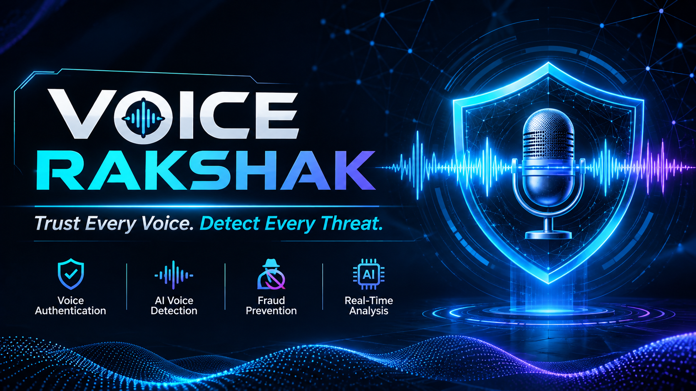

<!-- ===================================================
 ARYAN MANE | FUTURISTIC AI DEVELOPER PORTFOLIO
 GitHub: aryanmane2007
==================================================== -->

# ARYAN MANE

### AI / ML DEVELOPER • ASPIRING RESEARCHER

*Exploring ideas. Building intelligence. Creating impact.*

📍 Pune, India | B.Tech AI & ML | AISSMS College of Engineering

---

## `01 ABOUT ME`

I'm Aryan Mane, an Artificial Intelligence and Machine Learning undergraduate who loves exploring new technologies, discovering new ideas and building meaningful projects.

- Pursuing B.Tech in Artificial Intelligence & Machine Learning at AISSMS COE.
- Interested in AI, Machine Learning and emerging technologies.
- Exploring research, intelligent systems and real-world applications.
- Participating in hackathons and technology projects.
- Passionate about space technology, exploration and innovation.

> "Dream big. Explore beyond limits. Build the future."

---

## `02 TECH ARSENAL`

**PROGRAMMING LANGUAGES**

**TOOLS & TECHNOLOGIES**

**AREAS OF INTEREST**

`Artificial Intelligence`         · `Machine Learning`           · `Deep Learning`            · `Agentic AI` 
· `Computer Vision`               · `NLP`                        · `Data Analysis`            · `RAG Pipeline`

---

## `03 FEATURED PROJECTS`

### EXPLORE MY WORK

*Ideas transformed into experiments and applications.*

<table>
<tr>
<td width="50%" valign="top">

### AI-Based Plant Disease Detection System (SWARNA)

AI-powered plant disease diagnosis and farmer assistance.

`Python` `FastAPI` `MySQL` `Gemini API`

[**MORE INFO ↗**](https://aryanmane2007.github.io/aryanmane2007/?project=plant&view=info)

[**VIEW DEMO ▶**](https://aryanmane2007.github.io/aryanmane2007/?project=plant&view=demo)

</td>
<td width="50%" valign="top">

### AI Agent Verification & Safety (ZEROGO)

An independent verification layer that checks user intent, evidence and proposed AI-agent actions before execution.

`AI` `NLP` `Python` `Agent Safety`

[**MORE INFO ↗**](https://aryanmane2007.github.io/aryanmane2007/?project=groundtruth&view=info)

[**VIEW DEMO ▶**](https://aryanmane2007.github.io/aryanmane2007/?project=groundtruth&view=demo)

</td>
</tr>
<tr>
<td width="50%" valign="top">

### Climate & Disaster Intelligence (PrithviNet AI)

A climate-focused digital twin exploring environmental and geospatial intelligence, disaster awareness and water-resource planning.

`AI` `Geospatial Data` `Climate`

[**MORE INFO ↗**](https://aryanmane2007.github.io/aryanmane2007/?project=prithvinet&view=info)

[**VIEW DEMO ▶**](https://aryanmane2007.github.io/aryanmane2007/?project=prithvinet&view=demo)

</td>
<td width="50%" valign="top">

### AI Voice Fraud Detection (Voice Rakshak)

An AI-based concept for voice authenticity analysis and potential audio-fraud detection.

`Python` `Audio Processing` `AI`

[**MORE INFO ↗**](https://aryanmane2007.github.io/aryanmane2007/?project=voice-rakshak&view=info)

[**VIEW DEMO ▶**](https://aryanmane2007.github.io/aryanmane2007/?project=voice-rakshak&view=demo)

</td>
</tr>
</table>

*More projects and experiments coming soon...*

---

## `04 ACHIEVEMENTS & MILESTONES`

- 🏆 Cummins India Scholarship Recipient.
- 🚀 ISRO learning and visit opportunity through a school-level scholarship examination.
- 💡 Technology innovation and hackathon participation.
- 🎓 Diploma graduate in Artificial Intelligence & Machine Learning.

---

## `05 ESTABLISH CONNECTION`

### LET'S CONNECT & BUILD SOMETHING AMAZING

---

**`END OF TRANSMISSION // MORE INNOVATION AHEAD`**

